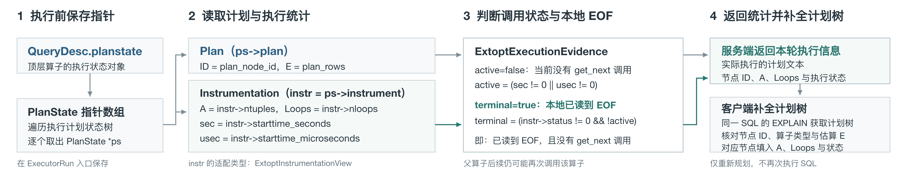
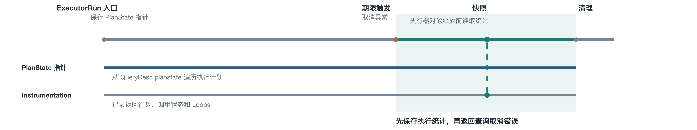
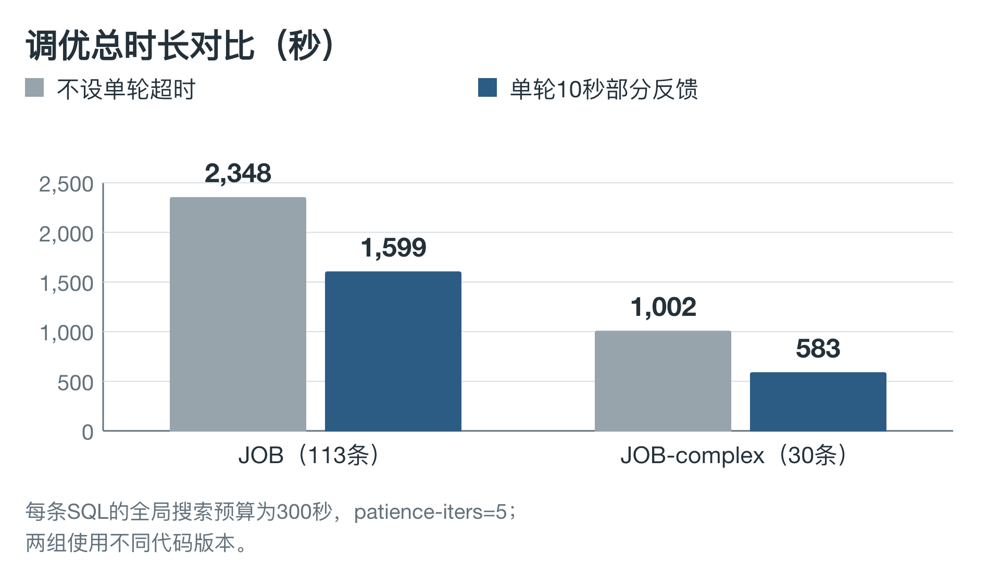
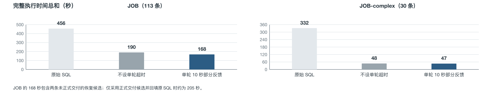

# 一种基于超时执行节点分级反馈的查询计划迭代优化方法及系统

## 缩略语

| 英文缩略语 | 完整的英文表述/英文标准用语 | 中文表述/中文术语 |
| --- | --- | --- |
| SQL | Structured Query Language | 结构化查询语言 |
| QEP | Query Execution Plan | 查询执行计划 |
| E-rows | Estimated Rows | 执行计划节点的估算输出行数 |
| A-rows | Actual Rows | 节点实际输出行数；在超时快照中指截至取消时的累计输出 |
| EOF | End of File / end-of-stream signal | 当前执行时期的数据流结束信号 |
| LEO | DB2's LEarning Optimizer | DB2 学习型优化器 |
| CE | Cardinality Estimation | 基数估计 |
| DOP | Degree of Parallelism | 并行度 |
| SDK | Software Development Kit | 软件开发工具包 |

## 摘要

数据库查询计划调优可以通过试运行候选计划，比较计划节点的估算输出行数与执行器产生的实际输出行数，修正下一轮规划的基数输入。对于执行时间较长的候选，如果一直等待其完成，单条候选会占用大量调优预算；如果达到单轮期限即直接取消，常规 `EXPLAIN ANALYZE` 结果路径又可能无法返回完整的节点统计。取消时留下的执行器观测具有不同可信程度：有的目标已经完成全部相关输出，有的只产生了可证明单调累加的部分输出，有的尚未运行或无法确定其统计口径。

本发明针对真实候选 SQL 的单轮限时试运行，在查询取消导致执行器对象清理之前，取得原候选物理计划及已运行节点的运行状态、估算行数和累计输出。方法先将节点观测绑定到下一轮拟修正的同一基数目标，并核对查询块、谓词、连接语义、调用次数和计数范围；随后结合当前执行时期是否到达 `EOF`、父节点是否仍可能重新调用该节点等事实，将观测分为目标完整值、同口径下界和无反馈三类。合格行数被用于下一轮独立候选的基数输入，取消候选的部分耗时则不被冒充为完整执行时间参与最佳候选比较。由此，在不等待慢候选完整结束的情况下，保留具有明确语义的执行反馈，并避免将局部或累计计数误用为最终基数。

本方法的业务目标是控制慢候选的单轮试运行时间，保留并利用已产生的有效节点统计，以降低整体调优耗时，为全局调优预算内的后续有效迭代争取时间，增加发现更优执行计划的机会。反馈是否可用和最终候选能否完整验证，决定这些机会能否转为实际交付收益。

## 1 相关技术背景以及最接近的现有技术

### 1.1 背景技术

在数据库运维和自动调优平台中，一批慢 SQL 通常需要在限定调优窗口内完成候选计划评估。某个候选长时间未结束，会推迟节点反馈和下一轮试运行，使剩余预算不足以继续验证其他候选。直接取消可以结束等待，但若本轮已经产生的节点统计未被保存并用于后续调优，执行尝试中的这部分信息也会被丢弃。

数据库优化器在执行 SQL 之前，需要从多个物理执行计划中选择一个计划。访问路径、连接顺序和连接方法的选择，都依赖中间结果基数，即扫描、过滤、连接或聚合节点预计输出的行数。优化器通常根据表统计信息、列分布和代价模型得到估算值；这些值记为 `E-rows`。候选计划真正运行后，执行器会产生实际输出行数；这些值在正常完整执行结果中通常称为 `A-rows`。

基数误差会沿计划树传播。例如，优化器将连接结果估计为几十行，可能选择让该结果驱动 Nested Loop；如果实际输出达到数万行，内侧访问会被反复调用，扫描、连接和后续排序的工作量都会增加。错误的中间基数还可能使优化器选择不适合的数据访问路径、连接方法或内存配置。因此，单纯改进静态统计信息并不能覆盖所有运行时数据分布和谓词组合，数据库系统逐渐形成了“执行—观测—修正—再次规划”的执行反馈调优路径。

在本发明涉及的调优流程中，系统为同一原始 SQL 生成多个候选。候选可以由不同 Rows Hint、Outline 或其它规划输入形成；每个候选都拥有自己的物理计划和独立执行上下文。调优器试运行候选，收集可用的节点行数，并将这些行数转换为下一轮候选的基数输入。这里有两个必须分开的结果：节点行数用于回答“下一轮应怎样估计和规划”，完整运行时间用于回答“哪个已经完成测量的候选更快”。一个候选因超时被取消时，可以仍然有前一种信息，但没有后一种完整信息。

慢候选使这一反馈路径出现两个连续的门槛。第一道门槛是时间门槛：等待候选正常结束，可能耗尽调优预算，后续候选无法及时运行。第二道门槛是语义门槛：取消时看到的 `ntuples` 是截至某一时刻的累计输出，不必等于某个 Rows 目标的最终基数；本地 `EOF` 也只表示当前执行时期结束，不能单独排除父节点未来再次调用该子树。若不保存观测，会丢失已完成或已足以证明低估的事实；若无条件使用所有观测，又会把未完成输出、跨多次调用的累计输出或不同查询语义的行数写入下一轮。

因此，本发明所处理的具体问题是：在真实候选达到单轮期限并被取消的现场，如何在执行器仍有效时取得节点事实，判断该事实对应的基数目标和调用范围，并据此形成可以被下一轮独立候选安全消费的分级反馈。


*图1 计划结构在候选开始时已经生成；完整执行可产生完整时间和常规节点统计，超时取消会中断正常结果路径。本发明在取消现场保留原计划结构及部分节点运行观测，只有通过语义判定的行数才进入下一轮。*

### 1.2 现有技术一：执行反馈驱动的基数修正

#### 1.2.1 技术方案

执行反馈调优的共同思路，是将计划阶段的估算与执行阶段取得的实际信息建立对应关系，再把误差用于未来规划。DB2 的 LEO 在计划和执行过程中积累算子计数，用于改进后续相似查询；其公开论文强调，学习信息可在查询完成后保存并用于后续优化。Oracle 12c 的 statistics feedback 在执行后比较计划操作的估算和实际行数，形成后续执行的反馈；Oracle 的 dynamic statistics 则属于编译期间针对统计查询的采样路径，两者不能混为一个机制。SQL Server 的 CE feedback 公开了对重复或相似查询的估算偏差分析，并可以将修正以 Query Store hint、模型参数或统计信息等形式保存。

这类技术确立了三个已知事实：第一，反馈对象可以细化到计划操作或计划节点；第二，反馈可以改变后续查询的基数估计和计划选择；第三，执行反馈与候选计划的最终性能评价可以分别处理。它们是本发明的技术基础，不能作为本案单独的区别点。[R1][R3][R14]

#### 1.2.2 与本发明相关的局限

按照 LEO、Oracle statistics feedback 等公开流程，完整的执行反馈通常在查询完成或完整的执行统计可用后形成。对于单次运行时间较长的候选，这一时点可能晚于调优器的单轮预算。直接等待会减少能够探索的候选数量；直接取消又可能使正常 `EXPLAIN ANALYZE` 结果不再返回。

但是，不能把这一局限表述为“所有已有反馈都必须等 SQL 完全结束”。Oracle 的其它公开资料和专利已经涉及运行中统计、部分执行和提前终止；Microsoft 的 CE feedback 专利也描述了执行中事件和后续查询反馈。准确的问题是：这些资料没有被本案所核对的单一公开文本明确组织为“外部单轮期限取消—清理前取证—逐目标完成性证明—完整值/下界/无反馈—下一轮独立候选基数输入”的完整数据依赖链。[R19][R22]

### 1.3 现有技术二：运行中重优化、部分执行统计与节点反馈

#### 1.3.1 IBM Progressive Optimization（`US7716215B2`）

IBM 的 Progressive Optimization 在 QEP 中插入 `CHECK` 算子，将优化器估算与执行中已处理的行数比较。该专利说明书 `p-0040` 将其概括为：`CHECK` 算子比较 “the optimizer's cardinality estimates with the actual number of rows processed thus far”。权利要求 1 还同时设置剩余执行时间阈值和估算误差阈值，在两者满足时暂停当前计划、重新优化并重新启动当前查询。

该专利已经公开两种对本案有直接影响的判断。其 `p-0065` 说明，输出达到第 `b` 行时可以在子流尚未结束前确认越过上界；若要根据输出不足确认低于下界，则要等子流返回 `EOF`。其 `p-0088` 还写明可以取得 “for all nodes of a QEP, not only for the materialization point” 的基数统计并反馈给后续重优化阶段。因此，前缀输出超过估算、等待 EOF 证明输出不足、以及收集多个计划节点统计，均不能单独作为本案发明点。[R20]

本发明与该技术的拟区别在于执行边界和证据组织方式。IBM 的核心流程是在当前查询计划中预置检查点，并在检查点触发后重规划当前查询；本发明针对外部调优器产生的真实候选，在未预置专用检查点的情况下，到单轮期限才取消候选，并在执行器清理前读取原计划的运行快照。更重要的是，本发明不把所有已读取行直接作为重规划输入，而是先对下一轮目标的语义、调用范围和未来重入风险作判定，再向下一轮独立候选发布分级证据。

#### 1.3.2 Oracle `US11321317B2`：用户终止背景、运行中换计划与后续反馈

Oracle 这件专利比“部分执行统计用于后续查询”更接近本案。说明书 `[0009]` 明确讨论了运行过久的 *catastrophic plan*：用户或 DBA 可以终止该计划，随后需要采取措施避免同一计划再次被选择。该段是问题背景，尚未规定终止现场的逐节点快照或证据分级。

专利还公开三条相互关联但消费对象不同的流程。第一条是 adaptive plan：在计划中放置 statistic collector 和 buffer，执行到决策点时根据已处理行数、选择率或不同值数量选择多个子计划中的一个；替代子计划可以使用原计划的部分结果，也可以从头执行。[0033]-[0045][0054] 第二条是 in-flight reoptimization：`[0105]`–[0107] 明确允许在计划尚未完成时，根据运行统计与编译估算的显著差异、剩余操作和更新后的候选成本，终止当前计划并启动重新编译或重新优化后的计划。这两条都是在**当前查询仍在执行时**从当前计划切换到其它计划。第三条是 automatic reoptimization：第一条查询可以完整执行，也可以只执行第一计划或其中一部分后结束或切换；运行中收集的表、连接、分组和索引基数等统计可保存并供相同、等价或相关的后续查询使用。[0083][0084][0087] 这里的“部分执行”不是把原 SQL 拆成多个简单 SQL；专利中另有 dynamic sampling 等编译期统计查询，属于不同阶段。

本案的执行边界不同：本案不在当前候选内部动态切换计划，而是针对同一 SQL 的第 `i` 轮候选设置外部执行期限；期限到达后取消该候选，在执行器清理前捕获可用节点信息，再将通过证据判定的行数用于同一 SQL 第 `i+1` 轮候选的基数修正。

Oracle 判断这些部分统计是否可用，主要看三种条件：统计是否足以区分 adaptive plan 的子计划；统计是否足以证明当前计划误估严重且替代计划成本更低；统计对应的数据库对象、操作和 bind value 是否与后续查询相关。Oracle 所核文本没有把部分统计分为目标级 `EXACT`、`LOWER_BOUND` 和 `NONE`，也没有明确要求用父链未来重入和累计/单次调用范围证明节点 A-rows 的完整性。[0037][0098][0105]-[0107][0114]-[0117]

因此，本案不能把“用户可以终止长计划”“部分执行统计用于未来查询”或“未完成计划被终止后换计划”作为宽泛区别。Oracle 已经公开了部分执行、用户/系统终止、运行中换计划、操作级统计和后续查询反馈。需要保持精确的区别是：所核文本没有明确写出外部固定期限取消后在执行器清理前保存全树节点事实，也没有给出沿父链未来重入、调用口径和累计/单次计数对每个 A-rows 输出 `EXACT/LOWER_BOUND/NONE` 的规则。[R19]

#### 1.3.3 Microsoft `US11334538B2`：节点级 CE feedback

Microsoft 的 CE feedback 专利说明书 `[0024]` 公开，查询监测器可以在 “during and at the completion of execution of the queries” 产生事件信号；`[0026]` 进一步说明 profile data 可以包含 “estimated and actual cardinality values for each node in a query plan”。授权权利要求 1 要求根据估算基数与实际基数的差异形成反馈建议，权利要求 5 允许该建议改变后续相同或相似查询的执行。

该专利直接证明了“执行期节点基数—估算误差—后续查询反馈”已经是公开技术路线，不能将微软概括为只提供语句级监控或只用于排障。其所核文本没有明确说明，在查询被外部单轮期限取消后，如何在执行器释放前保存原计划、怎样区别已完成目标和可能重入目标、怎样处理累计输出与单次估算不一致，以及如何将未完成观测限定为仅抬高估算的下界。[R22]

#### 1.3.4 Microsoft `US7493337B2`：算子上下界与进度估计

Microsoft 的查询进度专利以当前查询进度估计为主题。权利要求 27 明确要求将算子在某一时点已返回的项目数设为下界；权利要求 33 要求对多个查询算子维护上下界并传播边界变化。说明书 `p-0089` 称可以用执行反馈修正优化器初始估算，`p-0091` 还写道，当节点估算超出上下界时 “the optimizer is updated”。权利要求 42 允许用户中止查询。

因此，算子已输出量作为下界、多个节点的边界传播和执行期间的估算修正均已有公开。所核文本的主要用途是当前查询的进度估计和展示；没有在同一权利要求链中明确要求中止现场把该下界变成下一轮独立候选的 Rows 输入。权利要求 42 的中止入口和权利要求 27 的下界机制属于不同权利要求链，不能机械拼成一个已公开的完整实施例。[R21]

#### 1.3.5 对“中断后逐节点 A-rows 是否可信”的直接对照

“允许中断查询”和“中断后判断每个节点的 A-rows 是否可用于下一轮优化”是两个不同层次。前者只回答执行能否提前停止，后者还要回答观测覆盖哪个目标、是否已经完成、是否可能再次调用以及计数是否与估算同口径。对五件重点专利逐项对照如下：

| 专利 | 是否公开中断或提前终止 | 是否取得节点级行数/状态 | 是否公开中断后逐节点可信性分级 | 与本案关系 |
| --- | --- | --- | --- | --- |
| IBM `US7716215B2` | 是。权利要求 1 在计划内检查点满足时间阈值和误差阈值后暂停当前计划并重启 | 是。比较检查点已处理行数，说明书还设想 QEP 全节点统计 | 部分公开。`p-0065` 用子流 `EOF` 和越过上界判断特定检查点的证据，但未见外部期限取消后对整棵原计划逐节点输出 `EXACT/LOWER_BOUND/NONE` | 最接近“运行中判断行数可信度”，但服务当前查询的检查点重优化 |
| Oracle `US11321317B2` | 是。`[0105]` 公开依据运行中统计提前终止未完成计划 | 是。可收集表、连接、分组、索引等操作统计 | 未见明确分级。说明书承认统计可能只来自已读取子集，但未给出取消现场按未来重入和调用口径逐节点判定的规则 | 最接近“部分执行统计用于以后查询”，但缺少本案的证据分类链 |
| Microsoft `US11334538B2` | 所核文本未明确外部取消或用户中止作为触发条件 | 是。`[0026]` 明确每个计划节点的 estimated/actual cardinality | 未见。反馈管理器依据估算差异形成建议，但未规定取消后哪些节点可视为完整值或下界 | 最接近“节点 profile 反馈后续查询”，不等于中断取证 |
| Microsoft `US7493337B2` | 是。权利要求 42 公开用户 abort；另有执行期间进度估计 | 是。对多个算子维护输出量、上下界和状态，并按算子规则传播 | 部分公开。权利要求 27 和说明书 `p-0089`、`p-0091` 具有算子下界和边界修正，但用途是进度估计；未见中止后回灌下一轮独立候选 | 最接近“节点输出能否作为下界”，但中止入口与下界反馈不在同一权利要求链 |
| Sybase `US9213740B2` | 是。`[0194]` 公开 DBA 因运行过久中止当前计划 | 主要是计划级部分耗时和 `plancost`，未见节点 A-rows | 有筛选，但只判断部分耗时能否证明计划劣于最佳计划 | 证明中断轮次可以有用，但不涉及节点基数可信性 |

因此，五件专利中可以确认有中断或提前终止机制的是 IBM、Oracle、Microsoft `US7493337B2` 和 Sybase；Microsoft `US11334538B2` 的所核文本主要描述运行事件和反馈链，没有明确写出取消触发。能够对节点输出作局部可信解释的主要是 IBM 的 `EOF`/阈值逻辑和 Microsoft `US7493337B2` 的算子上下界；能够把节点基数送到后续优化的主要是 Oracle 和 Microsoft `US11334538B2`。但本案所强调的三个动作在所核文本中没有被明确连成一条链：

1. 在**外部单轮期限取消**而非预置检查点或人工进度控制的现场，保存原候选计划和各节点状态；
2. 针对每个待反馈目标，依据 `EOF`、父链未来重入和累计/单次调用范围，判断 A-rows 是完整值、可用下界还是不可用；
3. 只把前两类证据送入下一轮独立候选的基数输入，并保持取消候选的完整时间评价独立。

这三个动作构成“中断后逐节点 A-rows 可信性判定”的核心。单独的中断、节点计数、`A>E`、`EOF` 或后续反馈都不足以覆盖该核心。

### 1.4 现有技术三：取消候选评价与运行画像

#### 1.4.1 Sybase `US9213740B2`

Sybase 的自动调优专利在计划级别学习候选性能。说明书 `[0130]` 规定，即使执行被中止，也可以记录 “partial ‘plancost’ information”，并且 “only partial elapsed time is needed”。`[0194]` 进一步描述管理员因计划运行过久而中止当前计划；执行虽然 “incomplete”，系统仍跟踪计划指标。若已耗时间超过当前最佳计划，便可将该候选记录为以后应避免的坏计划；否则把中断当作无效训练执行。

这说明中断轮次并非必然没有有益信息，也说明部分信息可以经过“足以证明劣势/不足以证明”的筛选后参与后续计划选择。其证据对象是计划级已耗时间和性能指标，所核文本没有将取消时的逐节点行数绑定到基数目标，也没有规定节点完整值、下界和无反馈的分类。[R23]

#### 1.4.2 数据库产品的运行观测

Oracle SQL Monitor 在取消长查询后仍可显示计划行的 `Rows (Actual)`；其 `V$SQL_PLAN_MONITOR.OUTPUT_ROWS` 是执行开始后的累计输出，并可结合 `STARTS` 解释每次启动的平均输出。Microsoft Live Query Statistics 和 `sys.dm_exec_query_profiles` 公开算子级 `row_count`、`end_of_scan_count`、`rewind_count`、`rebind_count` 和估算行数。MariaDB、Redshift、OceanBase 等产品也提供执行中的计划或步骤行数、活动状态、循环或重扫信息。[R4][R5][R6][R9][R15][R16][R17]

这些产品资料说明，读取运行中或取消后的节点观测本身并不新颖；字段也不能单独证明该节点以后不会重入。所核产品文档主要面向监控、诊断和进度展示，没有明确描述本案要求的目标语义核对、证据分级和下一轮独立候选基数回灌。该结论只针对所核公开文档，不推断产品内部没有其它实现。

#### 1.4.3 采样式重优化及当前查询自适应执行

Sampling-Based Query Re-Optimization 在正式查询执行前对样本运行候选计划，依据采样得到的连接选择率迭代重规划；论文还允许对采样重规划过程设置时间预算，并在预算到达时返回目前成本较好的候选。其估计器具有无偏和强一致性质，但有限样本仍带来方差、采样成本和覆盖范围限制。[R2]

Oracle adaptive plan、Databricks AQE 等技术可以在当前查询执行中利用统计收集器、已完成的 shuffle 或其它阶段结果切换后续子计划。它们改变的是当前查询的剩余执行，数据来源也不同于“真实候选达到外部期限后，从执行器快照中取证并用于下一轮独立候选”。[R3][R8][R18]

### 1.5 现有技术对照与本案要解决的缺口

下表把五件专利公开的主要环节与本案拟组合的处理链分开列出。表中“未在所核文本中明确”是检索结论，不是对全部现有技术的否定。

| 技术环节 | 五件专利中已明确公开的内容 | 本案拟组合的附加限定 |
| --- | --- | --- |
| 执行中取得实际行数 | IBM `US7716215B2`、Oracle `US11321317B2`、Microsoft `US11334538B2`、Microsoft `US7493337B2` | 期限到达后，在外部取消异常展开和执行器清理之间取得原候选快照 |
| 部分执行或中断仍有信息 | Oracle公开部分执行统计；Sybase公开中断候选的部分耗时 | 对取消候选的节点事实按目标语义筛选，而不是仅记录计划级耗时或任意部分统计 |
| 前缀行数/下界 | IBM公开越过上界和等待 EOF 的判断；Microsoft `US7493337B2`公开算子下界 | 只有与待修正目标、谓词、连接类型、调用范围同口径时，才发布 `LOWER_BOUND`；否则不反馈 |
| 已完成状态 | IBM的子流 `EOF`、Microsoft的算子终止及产品中的扫描结束计数 | 将局部执行时期结束与目标级“未来不再输出”区分，并检查父链潜在重入 |
| 后续优化器消费 | Oracle部分执行统计、Microsoft CE feedback、IBM后续重优化 | 仅进入下一轮独立候选的基数输入；取消候选的期限不作为完整运行时间 |
| 证据分级 | 五件专利分别公开部分组件，但所核单篇文本未明确同时给出三类结果 | `EXACT`、`LOWER_BOUND`、`NONE` 的顺序判定和合并规则 |

最接近的公开技术已经分别覆盖了限时或中断候选、逐节点运行观测、前缀下界和后续计划修正。因此，本案不应把任一单点手段写成首创，也不应笼统声称“已有技术只能在完整查询结束后获得任何信息”。本案拟解决的是一个组合问题：对于非预设检查点的外部期限取消，如何将执行器清理前的局部事实转化为具有可证明边界的下一轮基数证据，同时避免把部分执行时间、局部 `EOF` 或跨调用累计行数解释过度。

### 1.6 本发明要解决的技术问题

本发明要解决的技术问题可以表述为：在多轮独立候选计划调优中，候选 SQL 受单轮执行期限约束并可能在未完成时被取消。如何在不等待该候选完整结束的前提下，及时取得执行器中的计划节点事实；如何判断每个事实对应的基数目标、数据语义和调用范围；如何区分可以作为最终值的观测、只能作为纠正低估的下界和不应使用的观测；以及如何把前两类证据送入下一轮规划而不污染最佳候选的完整时间评价。

## 2 本发明技术方案的详细阐述（发明内容）

### 2.1 技术方案的基本定义

设第 `i` 轮候选的原物理计划为 `P_i`，单轮期限为 `τ_i`，取消时刻为 `t_i`。计划中的一个可反馈目标记为 `k`。目标不是简单的节点编号，而是由以下语义共同确定的对象：查询块、涉及的关系或中间关系、谓词范围、连接类型、外侧参数或绑定值、并行/调用范围、数据可见性和统计口径。两个节点即使读取同一张表，只要谓词、连接位置或调用范围不同，也不能直接互用行数。

对目标 `k` 定义：优化器在本轮给出的同口径估算为 `E_i(k)`；取消时已取得的同口径累计输出为 `A_i(k,t_i)`；若候选继续执行到该目标的全部相关调用结束，目标最终输出为 `C_i(k)`。只有目标映射和计数口径均成立时，`A_i` 才能参与下列判断：

- 若能够证明目标的全部相关调用已经结束，且从取消时刻起该目标不会再输出，则 `A_i(k,t_i)=C_i(k)`，形成 `EXACT` 证据；
- 若不能证明目标已经结束，但后续输出只会在同一目标和同一调用范围内累加，则 `A_i(k,t_i)≤C_i(k)`。当 `A_i(k,t_i)>E_i(k)` 时，可以证明原估算低于已经发生的输出，形成仅用于抬高基数的 `LOWER_BOUND` 证据；
- 节点未运行、目标不能唯一绑定、计数跨多次调用而估算只表示单次输出，或者其它必要条件不成立时，形成 `NONE`，不发布该节点的行数反馈。

`A_i≤E_i` 在目标尚未完成时不能证明最终值小于估算；`status` 已表示本地 `EOF` 也不能单独证明父节点以后不会再次调用该节点。上述规则的核心是先证明观测的语义，再解释数值大小。

### 2.2 本发明的主要发明要点概述

本发明将一次限时候选试运行分成相互独立的两个结果通道。

第一条通道是**候选性能通道**。候选正常完成时，记录完整运行时间并参与最佳候选比较；候选因期限取消时，只保留已耗时间事实，不把 `τ_i` 当作完整运行时间，也不据此把未完成候选直接选为最佳候选。

第二条通道是**节点证据通道**。候选被取消时，在执行器对象清理前保存原计划结构和已运行节点的运行事实；将事实映射到同一基数目标，结合执行器状态和父子调用关系判断目标是否真正完成；把合格事实分成 `EXACT`、`LOWER_BOUND` 和 `NONE`；再把 `EXACT` 或符合条件的下界合并到下一轮独立候选的 Rows 输入。

本发明的拟保护重点是两条通道在规定时序和语义条件下的组合：超时只终止候选的本次执行，不终止已产生的可证明节点证据；节点证据可以推进下一轮基数规划，但不会改变完整候选时间的评价口径。

### 2.3 本发明的技术方案

#### 2.3.1 本发明应用的系统架构或场景

如图2所示，系统包括候选生成单元、限时执行单元、执行器观测单元、目标映射与证据判定单元、反馈合并单元和迭代控制单元。

候选生成单元接收原始 SQL、已有基数反馈和调优约束，调用现有优化器生成候选计划 `P_i`。限时执行单元为该候选设置 `τ_i`，执行成功时输出完整运行时间，超过期限时发出取消请求。执行器观测单元在取消异常展开但执行器对象尚未释放的窗口内，沿原候选的状态树读取计划结构、节点身份和运行计数。

目标映射与证据判定单元将节点观测映射到候选的 Rows 目标，检查查询块、关系、谓词、连接类型、调用次数和计数范围，并输出 `EXACT`、`LOWER_BOUND` 或 `NONE`。反馈合并单元按照证据强度合并同一目标的观测，形成下一轮 Rows 输入。迭代控制单元再次调用优化器，直到达到全局调优预算、收敛条件或其它停止条件。

系统可由数据库内的执行观测模块与外部 `hint_adviser` 协作实现，也可将这些模块集成在一个数据库服务中。计划文本、快照传输方式和 Rows Hint 语法可以随部署方式变化，但不能改变目标绑定和证据判定的语义。


*图2 候选 SQL 受单轮期限约束；取消时保存原计划及部分运行事实，只有通过证据判定的行数进入下一轮。完整运行时间只由正常结束的候选提供。*

#### 2.3.2 本发明核心装置和产品实现

执行观测必须同时回答两个问题：行数来自哪一个物理计划节点，以及该节点在取消时执行到了什么阶段。以当前 GaussDB 外置优化器适配为例，一次候选执行由 `QueryDesc` 定位，`QueryDesc.planstate` 指向根 `PlanState`；每个 `PlanState` 关联静态 `Plan` 和运行时 `Instrumentation`。沿左右子树、Append、Subquery、InitPlan、SubPlan 等关系可以遍历本次候选的状态树。

| 对象或视图 | 读取内容 | 对证据判定的作用 |
| --- | --- | --- |
| `QueryDesc` | `planstate` 根节点、`estate`、`plannedstmt` | 定位本次候选的执行上下文和静态计划 |
| `PlanState` | 节点类型、父子关系、`plan`、`instrument` | 建立物理节点身份和调用拓扑 |
| `Plan` | `plan_node_id`、`plan_rows`、执行类型、并行度等 | 提供节点身份和原估算 `E` |
| `Instrumentation` | `running`、起始时间、`status`、`ntuples`、`nloops` | 提供活动线索、本地 EOF、累计输出和已关闭执行时期 |

在当前适配中，`Instrumentation` 的 `ntuples` 是节点累计输出；`nloops` 是已经关闭的 instrumentation 执行时期数，只能作为调用/重入分析的线索，不能直接等同于未来重扫次数。缺少 `Instrumentation` 表示当前没有可读的运行计数，不能解释为实际输出为零。当前 SDK 未公开完整私有结构定义时，适配层只读取表达节点身份、状态和计数语义所需的字段；具体布局随数据库版本适配。



*图3 `PlanState` 同时关联静态 `Plan` 和运行时 `Instrumentation`。前者提供节点身份与 E-rows，后者提供取消时的活动状态、局部 EOF、执行时期和累计输出；目标语义仍需在反馈判定阶段核对。*

#### 2.3.3 取消时的取证时点和状态解释

候选开始执行前，限时执行单元保存可遍历的 `PlanState` 关系并记录候选标识。执行期间，执行器更新各节点的 `Instrumentation`。期限到达后，系统向数据库发送取消请求；在取消异常继续传播、执行器资源尚未释放的窗口内，观测单元读取原计划和节点计数，形成快照，然后重新抛出原取消错误。快照失败时，不替换原取消结果，也不把不完整快照伪装成正常执行结果。

对普通行执行节点，可以按下表解释观测信号。每一项只说明局部事实，不能单独推出目标级完整性。

| 执行器信号 | 可以得到的局部事实 | 单独不能推出的结论 |
| --- | --- | --- |
| 缺少 `instrument` | 没有可读的运行计数 | 实际输出为零 |
| `running`、起始时间、`status`、`nloops` 或 `ntuples` 显示运行痕迹 | 节点曾进入执行或存在计数时期 | 节点已经完成全部相关输出 |
| 起始时间非零或 `running` 为真 | 当前计数时期在快照时仍活动 | 当前累计行数是最终值 |
| `status` 表示当前时期结束且无活动调用 | 当前执行时期到达本地 `EOF` | 父节点以后不会再次调用该子树 |
| `nloops>0` | 至少有一个计数时期已经关闭 | 不会发生下一次调用 |
| `ntuples` 有效且非负 | 截至 `t_i` 的累计输出 `A(v,t_i)` | 与单次 `plan_rows` 自动同口径，或可再乘以 `nloops` |

Nested Loop 内侧、参数化 SubPlan、可重入的物化或其它可能被父节点再次初始化的子树，必须结合父链和目标调用范围判断。一个节点在当前外侧输入下到达本地 `EOF`，仍可能在下一条外侧输入到来后重新输出。Microsoft 文档中的 `end_of_scan_count`、Oracle 的 `OUTPUT_ROWS` 与 `STARTS` 也说明，扫描结束事件和累计输出需要结合启动次数解释。[R4][R6][R9]



*图4 在执行入口保存状态树，取消异常展开时读取运行计数，再让原取消结果继续传播；读取窗口结束后执行器对象可能被清理。*

#### 2.3.4 本发明核心方法流程

如图5所示，方法按以下步骤执行。

1. **生成并限时执行候选。** 根据原始 SQL 和当前 Rows 输入生成候选 `P_i`，设置单轮期限 `τ_i`，记录候选标识和完整性评价所需的计划结构。候选正常完成时，记录完整运行时间和常规执行统计；候选超时或被取消时，转入步骤 2。
2. **在清理前采集快照。** 在执行器对象仍有效时，保存原候选的计划树、节点身份、`plan_rows`、运行状态、`ntuples`、`nloops` 和其它可用于调用关系判断的字段。没有运行痕迹的节点记为无观测，不能写成零行。
3. **建立目标映射。** 对每一份观测，确定其对应的查询块、关系或中间关系、谓词范围、连接类型、外侧参数、并行聚合范围和调用次数；同时核对 `plan_rows` 与 `ntuples` 是否表示同一目标。节点身份、计划拓扑或估算值不一致时，拒绝该观测或拒绝整轮快照。
4. **判定目标级完成性。** 当前执行时期到达 `EOF` 只能作为必要线索。沿目标到计划根检查是否存在会重新初始化或再次调用目标的父子边。只有当观测覆盖全部相关调用、当前目标已到本地 `EOF`、并且父链能够证明从 `t_i` 起不会再产生该目标输出时，才发布 `EXACT(A_i)`。
5. **判定同口径下界。** 如果无法证明目标完整，但已输出量对同一目标和同一调用范围只会累加，建立 `A_i≤C_i` 的前缀关系。当 `A_i>E_i` 时，发布 `LOWER_BOUND(A_i)`，只允许提高该目标的基数输入；当 `A_i≤E_i` 时不以此证明原估算过高，本轮对该目标发布 `NONE`。
6. **合并并进入下一轮。** 对同一目标保存原始观测值和证据类型。若新证据为 `EXACT`，用其完整值更新目标；若新证据为 `LOWER_BOUND`，取已有有效下界和新下界的较大值，但不覆盖已确认的精确值；若为 `NONE`，保持已有输入。查询语义、数据可见性或目标口径不可比时，拒绝合并或使旧证据失效。
7. **分离时间评价。** 取消候选的已耗时间可以用于判断其是否已经超过某个明确的淘汰阈值，但不冒充完整运行时间写入最佳候选的完整时间字段。下一轮候选使用步骤 6 的 Rows 输入继续规划，直至满足全局预算或停止条件。

单轮期限按已完成候选的运行时间动态调整：未取得完整运行时间时使用配置上限 `τ₀`；得到同一 SQL 的最佳完整运行时间 `t_best` 后，后续上限取 `min(τ₀, 1.25 × t_best)`。实际期限还受全局剩余预算约束，并保留取消、取证及重新规划所需时间。超时取消的耗时不参与这一计算。当前实验配置 `τ₀=10 秒`，例如最佳完整运行时间为 4 秒时，后续上限为 5 秒。

反馈函数可以写为：

```text
F_i(k) = EXACT(A_i),       若 Complete_i(k) = true 且目标口径一致；
         LOWER_BOUND(A_i), 若 Complete_i(k) = false、输出单调且 A_i > E_i；
         NONE,              其它情况。
```

其中 `Complete_i(k)` 是目标级证明，不是某个单独执行器字段的别名。它至少要求目标的相关调用已经全部覆盖，并排除从取消时刻开始的未来重入。对于无法分析的算子、并行计数未归一、参数化调用范围不明或计数异常的节点，返回 `NONE` 是安全的实施方式。


*图5 先核对目标和计数口径，再判定完整值或下界。`A>E` 只能在同口径、输出单调且未证明完成的条件下形成下界；`A≤E` 不足以证明估算过高。*

#### 2.3.5 反馈合并规则和适用边界

对逻辑目标 `k`，设上一轮保存的基数输入为 `B_i(k)`，本轮证据为 `F_i(k)`。一种实施方式采用以下合并规则：

```text
B_(i+1)(k) = A_i(k),                    F_i(k) = EXACT(A_i(k));
B_(i+1)(k) = max(B_i(k), A_i(k)),        F_i(k) = LOWER_BOUND(A_i(k));
B_(i+1)(k) = B_i(k),                     F_i(k) = NONE。
```

`EXACT` 不被新的较小下界覆盖；多个有效下界取较大值；精确值冲突、数据版本变化、谓词或连接语义变化时，应拒绝覆盖或使旧证据失效。若外部 Rows 接口只能表达正整数，输出层可以把零行转换为接口允许的最小值 1，同时保存原始 `EXACT(0)` 证据，不能把接口编码值反过来当作原始事实。

当前 GaussDB 实施例优先支持能够明确解释 `Instrumentation` 布局和计数语义的普通行执行节点。Hash 的 MultiExec 结果、并行节点、参数化子计划和其它计数聚合方式不明确的节点，应在完成计数归一或调用范围证明之前跳过。`NOTICE` 分帧、同计划传输校验、连接恢复等属于通信和部署实现；它们可以支撑系统可靠运行，但不是本发明的主要保护对象。

### 2.4 本发明的实施例

#### 2.4.1 同一取消时刻的三种节点状态

考虑一个由两个 `Scan` 和一个 `Join` 组成的候选计划。分支 R 已在本次候选中完成其唯一相关调用并到达 `EOF`，估算为 1,000 行，输出为 120 行。若父链能够证明该分支不会重入，则 120 行可作为 R 目标的 `EXACT` 值。分支 J 仍在输出，估算为 1,000 行，取消前已输出 2,400 行；由于输出只会累加，且计数与估算同口径，形成 `LOWER_BOUND(2,400)`，但不能声称最终值就是 2,400。分支 T 尚未启动，没有 `A_T`，形成 `NONE`，不能写成零行。


*图6 同一候选可以同时包含精确值、可用下界和无观测节点；证据类型由完成性和口径共同决定。*

#### 2.4.2 本地完成与目标完成不一致

图7左侧为 Nested Loop 内侧 Join。该节点在第一条外侧输入下输出两行并到达本地 `EOF`，快照时过去尚未发生重扫；但第二条外侧输入仍可能使其再次执行。此时“两行”是第一次执行时期的完整观测，不足以证明整个 Rows 目标已经完成，除非目标本身限定为该一次调用，或父链规则已经证明不会再调用。

图7右侧为一个每次调用估算十行、实际调用二十次且每次输出五行的节点。若 `ntuples` 为累计值，则累计输出是一百行，大于单次 `plan_rows` 十行；直接比较一百和十会错误地生成低估下界。必须取得分次计数，或把目标明确为累计调用范围；无法统一口径时返回 `NONE`。这也是为什么 `nloops` 只能作为调用范围线索，不能被简单命名为未来重扫次数。[R9]


*图7 左侧说明本地 `EOF` 不能排除未来重入，右侧说明累计 `ntuples` 超过单次估算不代表单次目标被低估。*

#### 2.4.3 多轮候选迭代

第一轮候选 `P_1` 因超时被取消。快照判定得到目标 R 的 `EXACT(120)`、目标 J 的 `LOWER_BOUND(2,400)` 和目标 T 的 `NONE`。调优器据此生成下一轮候选 `P_2`，其中 R 的估算替换为 120，J 的估算至少提升至 2,400，T 沿用原输入或其它有效来源。若 `P_2` 正常完成，其完整运行时间才可参与最佳候选比较；若 `P_2` 再次超时，则按相同流程形成新的证据。

如果早期取消没有任何通过证明的节点，调优器保留已有 Rows 输入并按全局预算决定是否继续。部分反馈推进的是基数迭代，不代表取消候选本身已经完成，也不改变完整候选时间的评价口径。

#### 2.4.4 当前 GaussDB `hint_adviser` 实施例

当前实现通过 `capture_executor_run` 在查询取消异常处理中尝试输出快照，然后重新抛出原错误；适配层从 `PlanState.instrument` 读取 `running`、起始时间、`status`、`ntuples` 和 `nloops`。客户端先核对原计划与重新规划的节点拓扑、操作文本和估算行数，再按观察状态决定是否将节点作为 `EXACT` 或 `LOWER_BOUND` 输入 Rows Hint。[C1][C2][C3]

这一实施例应按其真实边界理解：当前分类函数以“本地时期结束且没有已关闭时期”作为精确值线索，以 `A>E` 作为下界线索；它尚未对所有计划拓扑证明父链未来首次重入，也尚未把所有跨多次调用的累计 `ntuples` 归一为与单次 `plan_rows` 相同的目标。因此，若采用严格的目标级保护范围，应将父链重入排除、计数口径归一和跨轮语义一致性落实为实现条件；对于无法证明的节点，实施方式应返回 `NONE`。

#### 2.4.5 JOB 与 JOB-complex 系统级性能对照

在同一 GaussDB JOB 数据库上，对 JOB 的 113 条 SQL 和 JOB-complex 的 30 条 SQL 比较两个版本：未设置单轮 `EXPLAIN ANALYZE` 时限的“无单轮超时组”，以及初始单轮上限设为 10 秒并集成部分反馈的“10 秒部分反馈组”。两组均设置 `patience-iters=5`、300 秒调优搜索预算、初始计划验证、相同采样块数和优化器参数；查询采用交替顺序执行。由于两组使用不同代码版本，结果反映集成方案的系统效果，不能把全部差异单独归因于 10 秒参数。[E1]

调优结束后，原 SQL 与可用优化 SQL 在相同设置下各独立运行三次，主表取预先指定的第 3 次完整执行时间。未产生可用优化 SQL 的查询回填原 SQL。JOB `16b`、`18c` 在 10 秒组中因连续部分轮次未正式交付，但其最后累积 Rows Hint 形成的恢复候选经过 SQL 一致性核对后进行扩展评估，单独标注为恢复候选。286 次调优和 1,224 次独立执行均完成。[E1][E2][E3][E4]

| 数据集 | 查询数 | 正式交付 无单轮超时 / 10 秒部分反馈 | 扩展评估可用 无单轮超时 / 10 秒部分反馈 | 有效部分轮次 | 调优总时长（秒）无单轮超时 / 10 秒部分反馈 | 降幅 |
| --- | ---: | ---: | ---: | ---: | ---: | ---: |
| JOB | 113 | 103 / 103 | 103 / 105 | 183 | 2,348 / 1,599 | 31.89% |
| JOB-complex | 30 | 28 / 29 | 28 / 29 | 88 | 1,002 / 583 | 41.84% |



*图8 两组调优总时长。降幅由未舍入值计算，不表示每条查询均缩短。*

| 数据集 | 原始 SQL 总时间（秒） | 无单轮超时组总时间（秒） | 10 秒部分反馈组总时间（秒） | 后者变化 |
| --- | ---: | ---: | ---: | ---: |
| JOB | 456 | 190 | 168 | 降低 11.25% |
| JOB-complex | 332 | 48 | 47 | 降低 2.26% |



*图9 第 3 次独立完整执行时间之和。10 秒组采用扩展评估口径，JOB 包含两条未正式交付的恢复候选。*

上述结果表明，在固定工作负载和扩展评估口径下，10 秒部分反馈组降低了两个数据集的调优总时长，优化后执行时间之和也较低。该结果不等于每条 SQL 均加速。若严格只承认正式交付并将 `16b`、`18c` 回填为原 SQL，JOB 的 10 秒组执行总时间约为 205 秒，高于无单轮超时组的 190 秒；JOB-complex 不涉及这两条恢复候选。因而实验能够支持“限时部分反馈可缩短工作负载级调优时间”，而不能支持“正式交付下每个查询的执行时间均不退化”，也不能单独证明所有节点证据分类都正确。[E2][E3][E4]

## 3 本发明关键技术点概括及对应有益效果

### 3.1 本发明的关键技术点概括

五件专利分别公开了运行中基数比较、部分执行统计、节点级 CE feedback、算子下界和中断候选性能学习。本发明拟保护的是这些公开事实在外部期限取消的独立候选调优中的特定组合和依赖关系：

1. **取消清理前保存原候选事实。** 对真实候选设置单轮期限；期限触发取消后，在执行器对象有效期内保存原物理计划结构和已运行节点的状态、估算与累计输出。
2. **将观测绑定到同一基数目标。** 在使用任何行数前，核对查询块、关系或中间关系、谓词、连接类型、外侧参数、调用次数、并行聚合范围和数据可见性，确认估算与观测具有同一语义。
3. **按目标级完成性分级证据。** 结合本地 `EOF`、已关闭执行时期和父节点未来重入可能，只有证明目标全部相关输出不会继续增加时才给 `EXACT`；不能证明完成但同口径输出已超过估算时给仅抬高估算的 `LOWER_BOUND`；其余给 `NONE`。
4. **将证据用于下一轮独立候选。** 按证据强度合并 Rows 输入，精确值不被下界覆盖，多个下界取较大值，语义冲突或不可比观测拒绝合并。
5. **分离节点反馈和候选时间评价。** 被取消候选的行数证据可以推进下一轮规划；其部分耗时只作为已耗时事实或明确淘汰判断的依据，不替代正常完成候选的完整运行时间。

### 3.2 本发明的业务价值及对应有益效果

本方法面向数据库运维和自动调优平台中的限时慢 SQL 调优任务，旨在控制慢候选的单轮试运行时间，保留并利用已产生的有效节点统计，以降低整体调优耗时，为全局调优预算内的后续有效迭代争取时间，增加发现更优执行计划的机会。以下从单轮试运行的时间投入和后续迭代的探索机会两个方面说明业务价值。

#### 3.2.1 控制单轮试运行时间，保留有效反馈，降低整体调优耗时

一个候选长时间未结束时，持续等待会占用后续候选的规划和验证时间。直接取消能够结束等待，但如果没有取得和使用本轮节点统计，试运行已经产生的行数信息就无法继续用于调优。本方法在候选达到期限时取消执行，同时在执行器清理前取得已有统计；有合格行数时，将其用于下一轮基数修正。业务上的作用是控制一次慢候选试运行占用的时间，并保留这次执行尝试可供后续利用的信息。复用对象是节点行数与执行状态，不是中间数据表，也不是从取消位置恢复原查询。

现有固定工作负载对照中，集成部分反馈的版本将 JOB 调优总时长从 2,348.17 秒降至 1,599.41 秒，减少 748.76 秒（31.89%）；JOB-complex 从 1,001.57 秒降至 582.56 秒，减少 419.02 秒（41.84%）。这支持相应批次调优任务更快完成的观察。对照使用不同代码版本，不能将全部差异单独归因于时限参数。候选期限约束试运行执行，整轮还包含规划、取消清理和统计处理等开销。[E1][E2][E3]

#### 3.2.2 为全局预算内的后续有效迭代争取时间，增加发现更优计划的机会

当新的合格统计能够改变下一轮基数输入时，慢候选无需完整结束即可为后续规划提供反馈。相比把剩余时间集中用于等待当前候选，这让调优器有机会在全局预算内继续尝试其他候选。业务目标是提高有限调优窗口内的有效探索机会；有无新反馈、候选耗时和停止条件共同决定实际轮次，不能保证所有 SQL 的轮次都会增加。

JOB `16b` 的记录提供了一个具体例子。无单轮超时组完成 4 轮后触发全局预算停止条件，已经正式交付完整执行约 36.38 秒的候选。10 秒组完成 11 轮，全部为部分反馈轮次，最后累计的 Rows Hint 形成了约 10.99 秒的恢复候选，其三次独立完整测量均约为 11 秒。该案例说明部分反馈可以支持更多迭代并形成更快候选。该恢复候选当时未正式交付，将探索结果转为实际交付收益仍需完整执行验证及交付处理。[E2][E3][E4]

JOB 整套任务的总轮次实际为 569 → 528，JOB-complex 为 166 → 182。因此，轮次数量不是越多越好，也不是本方法保证增加的指标；重点是减少无效等待、让合格反馈推动必要的下一轮规划。最终候选仍需完整执行验证。JOB 正式交付候选数量两组同为 103；仅采用正式交付并回填原 SQL 时，10 秒组执行总时间约为 205 秒，高于无超时组约 190 秒，不能宣称已普遍提高最终交付质量。[E2][E3]

#### 3.2.3 技术机制与业务效果的关系

| 技术点 | 业务效果与成立条件 |
| --- | --- |
| 单轮执行期限及全局预算 | 控制一个慢候选持续占用调优窗口的时间，为后续规划、试运行和收尾留下时间；实际结束仍有取消和处理开销。 |
| 清理前读取节点统计 | 有可用于反馈的节点时，被取消的执行尝试仍能提供信息，减少丢弃已有行数观测造成的重复探索。 |
| 精确值、下界和无反馈判定 | 在查询语义、调用次数与计数范围可比时，按信息强度限制更新方向；无法确认的统计不作为有效反馈。当前原型仍需补齐部分严格判断条件。 |
| 跨轮行数合并 | 保留同一目标的合格反馈，精确值优先，下界取最大值，支持后续候选继续利用前轮所得信息。 |
| 行数与完整运行时间分开 | 部分统计可以推动基数迭代，已完整测量的候选仍承担最终性能评价，避免把短取消时间误作快计划。 |

限制慢候选执行时间还可能缓解调优任务对数据库资源的持续占用，但现有实验未单独测量 CPU、I/O、内存或并行业务请求延迟。这属于待验证的资源收益，不能把调优墙钟时间降幅等同于资源成本降幅。保护论证仍由具体统计获取、判定和合并机制支撑，业务目标不替代技术区别。

### 3.3 建议的保护边界层次

以下内容用于形成权利要求撰写时的技术层次，不是对授权结果的判断。

**方法独立层次。** 为真实候选 SQL 设置单轮执行期限；期限触发取消时，在执行器清理前取得节点估算行数、已返回行数和执行状态；对同一扫描或连接，按结果是否完整以及实际与估算的计数范围，判定精确值、可用下界或无反馈；按反馈类型合并到同一 SQL 下一轮独立候选的基数输入。精确值允许上调或下调，合格下界仅抬高，无合格统计保持原值。

**装置或系统层次。** 系统包括候选生成、限时执行、清理前统计采集、行数判定、反馈合并和迭代控制模块；行数判定模块依据执行状态、父子调用关系和计数范围产生对应反馈类型，反馈合并模块按类型约束后续基数更新。

**从属限定层次。** 可以进一步限定：在本地 EOF 之外检查父算子是否还需再次调用；对累计行数与单次估算进行换算或不反馈；只在可直接比较且 A > E 时发布未完成节点的合格下界；精确值优先于下界，多个下界取最大值；查询条件或数据变化时使旧证据失效；无法确定统计范围的节点不反馈；单轮期限取配置上限、最佳完整时间乘倍率和可用全局剩余预算的较小值。取消耗时不用于更新最佳候选的完整运行时间。

**实施说明。** `QueryDesc`、`PlanState`、`Plan`、`Instrumentation`、NOTICE 消息、连接恢复，以及取消后重新规划、重建 JSON 计划及与原计划匹配，描述当前代码的统计读取和防护方式。重新规划与计划匹配不列入本次拟保护点，不作为一般行数反馈方法的必要步骤；也可以由执行器直接提供原计划结构及节点统计。

IBM、Oracle、Microsoft 和 Sybase 已公开相关执行反馈、部分统计、行数下界或中断学习机制。保护论证应落实到期限取消后行数的适用判定、更新方向和跨轮合并的连续关系；不能仅凭标签、同一 SQL 或参数取值判断创造性。

## 参考资料与实现依据

### 现有技术与论文

- [R1] Stillger 等，*LEO - DB2's LEarning Optimizer*，VLDB 2001，[本地论文 PDF](../sources/papers/P019.pdf)。
- [R2] Wu 等，*Sampling-Based Query Re-Optimization*，SIGMOD 2016，[本地论文 PDF](../sources/papers/1601.05748v1.pdf)。
- [R3] Zait 等，*Adaptive Statistics in Oracle 12c*，PVLDB 10(12), 2017，[论文](https://vldb.org/pvldb/vol10/p1813-zait.pdf)。
- [R4] Oracle Database 19c，[Monitoring Database Operations](https://docs.oracle.com/en/database/oracle/oracle-database/19/tgsql/monitoring-database-operations.html#GUID-11748F62-BE24-4511-B77B-F28D5E443A0A)。
- [R5] Microsoft Learn，[Live Query Statistics](https://learn.microsoft.com/en-us/sql/relational-databases/performance/live-query-statistics?view=sql-server-ver17)。
- [R6] Microsoft Learn，[sys.dm_exec_query_profiles](https://learn.microsoft.com/en-us/sql/relational-databases/system-dynamic-management-objects/sys-dm-exec-query-profiles-transact-sql?view=sql-server-ver17)。
- [R7] Microsoft Learn，[Query Profiling Infrastructure](https://learn.microsoft.com/en-us/sql/relational-databases/performance/query-profiling-infrastructure?view=sql-server-ver17)。
- [R8] Oracle Database 12c，[How Adaptive Query Plans Work](https://docs.oracle.com/database/121/TGSQL/tgsql_optcncpt.htm#GUID-A42B8874-95AF-4D5B-B5D9-F0376F91D15E)。
- [R9] Oracle Database 19c，[`V$SQL_PLAN_MONITOR`](https://docs.oracle.com/en/database/oracle/oracle-database/19/refrn/V-SQL_PLAN_MONITOR.html)。
- [R10] Kabra、DeWitt，*Efficient Mid-Query Re-Optimization of Sub-Optimal Query Execution Plans*，SIGMOD 1998，[论文](https://www.cs.cmu.edu/~natassa/courses/15-721/papers/reopt.pdf)。
- [R11] Markl 等，*Robust Query Processing through Progressive Optimization*，SIGMOD 2004，[论文](https://dsf.berkeley.edu/cs286/papers/robust-sigmod2004.pdf)。
- [R12] Chaudhuri 等，*Estimating Progress of Execution for SQL Queries*，SIGMOD 2004，[论文](https://www.microsoft.com/en-us/research/wp-content/uploads/2016/02/progress-1.pdf)。
- [R13] Yang 等，*Balsa: Learning a Query Optimizer Without Expert Demonstrations*，SIGMOD 2022，[论文](https://zongheng.me/pubs/balsa-sigmod2022.pdf)。
- [R14] Microsoft Learn，[Cardinality Estimation Feedback](https://learn.microsoft.com/en-us/sql/relational-databases/performance/intelligent-query-processing-cardinality-estimation-feedback?view=sql-server-ver17)。
- [R15] MariaDB，[`SHOW ANALYZE FOR`](https://mariadb.com/docs/server/reference/sql-statements/administrative-sql-statements/show/show-analyze)。
- [R16] Amazon Redshift，[`SYS_QUERY_DETAIL`](https://docs.aws.amazon.com/redshift/latest/dg/SYS_QUERY_DETAIL.html) 与 [`SYS_QUERY_HISTORY`](https://docs.aws.amazon.com/redshift/latest/dg/SYS_QUERY_HISTORY.html)。
- [R17] OceanBase Cloud，[Execution Profile](https://en.oceanbase.com/docs/common-oceanbase-cloud-10000000001725119)。
- [R18] Databricks，[Adaptive Query Execution](https://docs.databricks.com/aws/en/optimizations/aqe)。

### 五件重点专利

- [R19] Oracle，*Leveraging query-specific statistics in non-equivalent queries*，`US11321317B2`；较早公开申请 `US20140095475A1`，[授权文本](https://patents.google.com/patent/US11321317B2/en)，[本地原件](patent-originals/US11321317B2.pdf)。重点为说明书 `[0009]`、`[0037]`、`[0083]`、`[0084]`、`[0087]`、`[0105]`–`[0107]` 及权利要求 1。
- [R20] IBM，*System, method, and computer program product for progressive query processing*，`US7716215B2`；较早公开申请 `US20050097078A1`，[授权文本](https://patents.google.com/patent/US7716215B2/en)，[本地原件](patent-originals/US7716215B2.pdf)。重点为说明书 `p-0040`、`p-0065`、`p-0088` 及权利要求 1。
- [R21] Microsoft，*Query progress estimation*，`US7493337B2`；较早公开申请 `US20050222965A1`，[授权文本](https://patents.google.com/patent/US7493337B2/en)，[本地原件](patent-originals/US7493337B2.pdf)。重点为权利要求 22、23、27、33、42 及说明书 `p-0089`、`p-0091`。
- [R22] Microsoft，*System and method for cardinality estimation feedback loops in query processing*，`US11334538B2`；较早公开申请 `US20200379963A1`，[授权文本](https://patents.google.com/patent/US11334538B2/en)，[本地原件](patent-originals/US11334538B2.pdf)。重点为说明书 `[0024]`、`[0026]`、`[0028]` 及权利要求 1、5。
- [R23] Sybase，*System and methodology for automatic tuning of database query optimizer*，`US9213740B2`；较早公开申请 `US20090100004A1`，[授权文本](https://patents.google.com/patent/US9213740B2/en)，[本地原件](patent-originals/US9213740B2.pdf)。重点为说明书 `[0130]`、`[0194]` 及权利要求 1。

五件专利的逐条英文引文、中文释义和重合边界见[专利重合分析报告](patent-timeout-feedback-overlap-analysis.md)；原始 PDF 清单见[原件索引](patent-originals/MANIFEST.md)。

五件专利按“触发—观测—判定—后续动作”拆解的逐步流程见[专利方法流程解析](patent-five-method-flow-analysis.md)。

### 当前实现依据

- [C1] [`process_one_query`](../contrib/hint_adviser/hint_adviser.c)、候选生成、限时执行和迭代控制。
- [C2] [`capture_executor_run`](../contrib/extopt-gaussdb/extopt_partial_capture.cpp)、[`partial_gaussdb_execution_capture_evidence`](../contrib/extopt-gaussdb/extopt_partial_gaussdb.cpp)：取消时取证和执行器字段来源。
- [C3] [`partial_observation_evidence`](../contrib/hint_adviser/hint_adviser_partial_proof.c)、Rows 目标收集和计划身份核对：证据判定与目标映射。
- [C4] [`rows_hint_merge`](../contrib/hint_adviser/hint_adviser_rows_state.c)、[`feedback_loop_advance`](../contrib/hint_adviser/hint_adviser_feedback_policy.c)：跨轮合并、部分轮次和最佳候选规则。
- [C5] [`hint_adviser_rows_target.c`](../contrib/hint_adviser/hint_adviser_rows_target.c)：Nested Loop 内侧及其它 Rows 目标边界。

### 实验记录

- [E1] [实验配置与版本指纹](../data/patience5-ab-20260928/run-manifest.txt)。
- [E2] [逐查询工作簿](../outputs/job_job_complex_tuning_query_summary_patience5_20260928.xlsx)及其输入明细。
- [E3] [独立执行原始记录](../data/patience5-ab-20260928/results/measurements.tsv)、调优记录和事件记录。
- [E4] [恢复候选来源明细](../data/patience5-ab-20260928/results/recovered-current-partial.tsv)及恢复规则。
- [E5] [调优时长图表的可编辑 PPT](patent-timeout-feedback-figures/pptx/fig8-tuning-duration.pptx)和[执行效果图表的可编辑 PPT](patent-timeout-feedback-figures/pptx/fig9-execution-effect.pptx)。

## English Summary

The business objective is to bound each slow candidate's trial execution and retain its usable operator statistics to reduce overall tuning time, leave time for useful iterations within the global tuning budget, and increase the chance of finding a better execution plan. Integrated workload tests reduced aggregate tuning duration by 31.89% on JOB and 41.84% on JOB-complex. More rounds or better delivery are conditional: total JOB rounds decreased from 569 to 528, while 16b increased from four rounds to eleven partial-feedback rounds and produced a faster recovered candidate. That candidate was not formally delivered, and formal JOB execution results do not establish a general final-plan quality improvement. CPU, I/O and production-concurrency benefits remain unmeasured.

Start with a configurable per-candidate timeout cap `T₀`, set to ten seconds in the current experiment. Once a best complete runtime `t_best` is available for the same SQL, reduce the cap for later candidates to `min(T₀, 1.25 × t_best)`. The actual deadline also respects the remaining global budget and reserves time for cancellation, capture, and replanning. Time spent on a cancelled execution does not enter this calculation.

This disclosure concerns iterative query-plan tuning under a per-candidate execution deadline. When a real candidate is cancelled, the original plan tree and supported operator observations are captured before executor cleanup. Each observation is bound to a cardinality target with the same query-block, predicate, join, invocation, and counting scope. A target is classified as `EXACT` only when all relevant invocations have completed and no future re-entry can produce more rows. An unfinished but monotone observation can produce a `LOWER_BOUND` only when its output exceeds an estimate with the same scope; otherwise it produces `NONE`. Accepted evidence informs the next independent candidate, while only normally completed candidates provide complete runtime for best-plan comparison. The disclosure distinguishes local EOF from target completion and cumulative instrumentation output from per-invocation estimates. On the fixed JOB and JOB-complex workloads, the integrated ten-second version reduced aggregate tuning time, while the JOB execution-time result depended on two recovered candidates that were not formally delivered.
