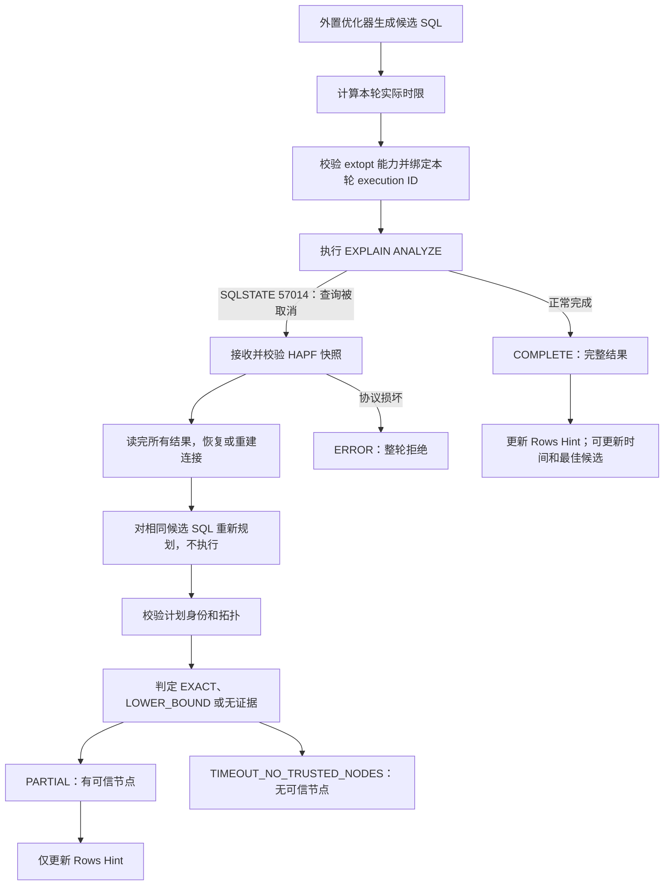
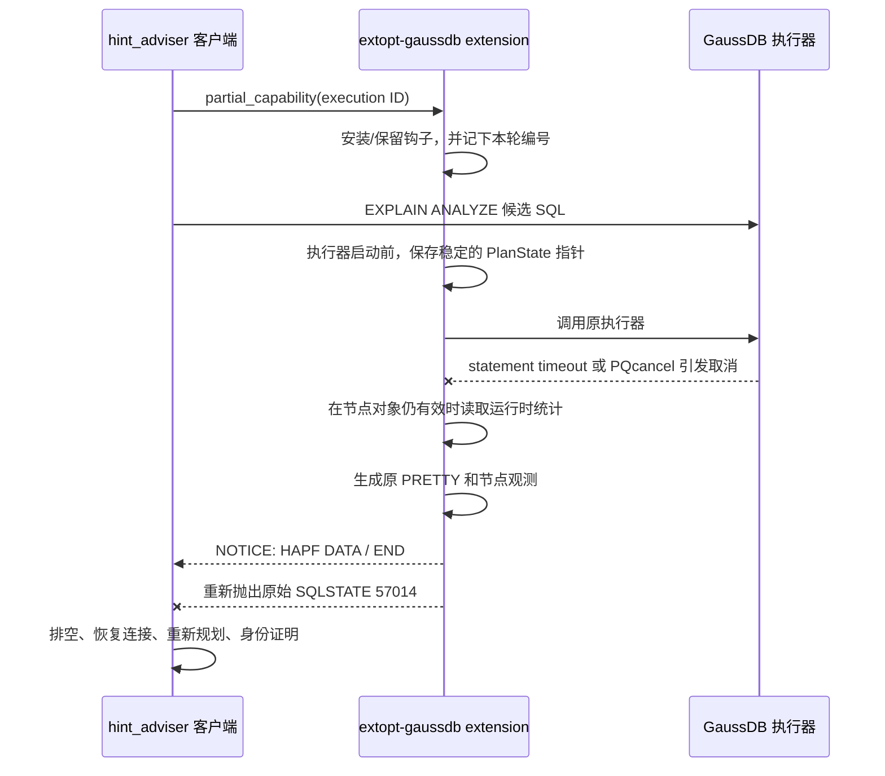

# 超时 EXPLAIN ANALYZE 与部分反馈需求串讲

## 1. 总结
`EXPLAIN ANALYZE`原有在超时时只会告诉客户端“查询已被取消”。它不会自动告诉客户端：

- 哪些计划节点已经执行；
- 哪些节点已经真正结束；
- 哪些实际行数可以当作精确值；
- 取消时的执行节点是否还能安全访问；
- 当前连接是否可以直接执行下一条 SQL。

因此，新方案同时改造了客户端 `hint_adviser`和安装在 GaussDB 侧的 `extopt-gaussdb` extension（数据库扩展模块）：

1. `hint_adviser` 把一次候选 SQL 的处理封装成 `feedback round`（单轮反馈：一次候选 SQL 的执行、取证、验证和结果判定）。
2. `extopt-gaussdb` 在查询取消时，趁执行对象还有效，生成 `HAPF snapshot`（本项目定义的超时执行快照）。
3. `hint_adviser` 收到快照后，用同一条候选 SQL 重新 Explain。并用得到的完整计划校验快照中的节点身份。
4. 只有通过“超时执行快照校验、计划身份一致性（结构映射：节点数量、父子拓扑、node id、query block、anchor）、节点执行状态”三重检查的实际行数，才能进入后续 Rows Hint 生成。
5. 超时候选 SQL 可以帮助下一轮规划，但不能参加最佳候选比较，也不能直接交付给用户。

## 2. 改造前后的主流程

### 2.1 改造前

```text
整个调优过程共享一个全局 search timeout
  动态采样
  生成初始 Rows Hint
  外置优化器生成候选 SQL
  执行完整 EXPLAIN ANALYZE
    成功 -> 构造 PlanNode -> 更新 Rows Hint -> 更新最佳候选
    全局时限耗尽 -> PQcancel 当前 SQL -> 当前轮失败 -> 终止调优循环
```

### 3.2 改造后



## 3. 一次单轮反馈怎样运行

### 3.1 第一步：计算本轮实际时限

用户新增配置 `--explain-timeout-ms`（每个候选 SQL 的单轮执行上限）：

- `-1`：关闭部分反馈，保留旧的完整执行路径。
- 正整数：启用单轮超时和部分反馈。

[`feedback_effective_timeout`](../contrib/hint_adviser/hint_adviser_feedback_round.c) 集中计算 `effective timeout`（本轮真正使用的时限）：

```text
本轮实际时限 = 取下列可用值的最小值
  用户配置的单轮时限
  全局搜索剩余时间 - 8000 ms 收尾保留时间
  已有完整最佳执行时间 x 1.25
```

### 3.2 开启本轮服务端捕获

`hint_adviser` 生成一个单调递增的 `execution ID`（本轮执行唯一编号），然后调用：

```sql
SELECT extopt.partial_capability(<execution_id>);
```

`partial_capability` 是一个开关函数。调用它只做一件事：**记下本轮编号**，让服务端抓取当前会话的
**下一次** `ExecutorRun`（GaussDB 执行计划的主阶段）。它不会立刻抓任何东西。`0` 表示关闭捕获。

编号的作用是区分轮次：快照里带着同一个编号，客户端只接受编号一致的消息。

`tuning_agent`、`libexternal_optimizer.so`、`extopt.so` 和目标 GaussDB SDK 必须来自同一套构建和部署产物；不支持新旧组件混装。

### 4.3 执行候选 SQL

`feedback_round_execute`（单轮反馈执行入口）会：

1. 保存会话原有的 `statement_timeout`（数据库语句超时设置）。
2. 打开 GaussDB PRETTY 输出。
3. 把 `statement_timeout` 设为本轮实际时限。
4. 执行 `EXPLAIN (ANALYZE, OUTLINE ON, BLOCKNAME ON) <candidate SQL>`。

取消有两条路径：

- 服务端先到时：`statement_timeout` 使 GaussDB 返回 `SQLSTATE 57014`（查询取消状态码）。
- 服务端未及时返回：客户端用 `PQcancel`（libpq 客户端通信库提供的异步取消请求）兜底。

两者不使用同一个截止时刻。客户端 watchdog（防止服务端长时间不返回的监视计时器）比服务端时限晚 `2500 ms`：

```text
watchdog 时限 = 本轮实际时限 + 2000 ms 快照上限 + 500 ms 调度余量
```

### 4.4 对相同候选 SQL 重新规划

超时快照故意不携带完整 JSON 计划树。因此客户端必须对本轮的准确候选 SQL 执行：

```sql
EXPLAIN (OUTLINE ON, BLOCKNAME ON) <candidate SQL>; -- PRETTY，不执行
EXPLAIN (FORMAT JSON) <candidate SQL>;               -- 完整结构，不执行
```

这里不能使用原始 SQL，也不能使用上一轮候选 SQL。否则快照中的节点可能与重建计划对不上。

[`candidate_plan_skeleton`](../contrib/hint_adviser/hint_adviser_plan_tree.c) 先建立物理 JSON 计划树，并对齐新 PRETTY。在部分证据校验通过后，[`candidate_plan_complete`](../contrib/hint_adviser/hint_adviser_plan_tree.c) 再补齐子查询 alias 和 Rows target（用于生成 Rows Hint key 的扫描/连接目标）。

### 4.5 对超时快照PRETTY、Explain PRETTY、Explain JSON进行比较

[`partial_prove`](../contrib/hint_adviser/hint_adviser_partial_proof.c) 把三份信息放在一起比较：

1. 快照中保存的原执行 PRETTY。
2. 对相同候选 SQL 重新生成的 PRETTY。
3. 重新生成的 JSON 计划树。

当前生产代码已实际执行的检查是：

- JSON 节点数、PRETTY 行数和 anchor 子计划的配对数量一致；
- 计划 ID 在 PRETTY 和观测中唯一，且观测可以找到唯一 PlanNode；
- 原执行 PRETTY 与重新规划 PRETTY 的 operation（带缩进的操作文本）、查询块和 E-rows 一致；
- JSON 树的父指针、PRETTY 缩进深度和整体节点数一致；
- JSON Plan Rows 四舍五入到 PRETTY 显示形式后，与重新规划 PRETTY E-rows 一致；
- 观测中的 A/E rows 与原执行 PRETTY 显示值一致；
- CTE/InitPlan/SubPlan（公用表表达式、初始化子计划和普通子计划）的 anchor（PRETTY 中用来标识子计划起点的行）可以匹配对应 JSON 子树；
- 引号内的 `|`、换行和类似 `, SubPlan 1]` 的文本只是名称内容，不误当分隔符或 anchor。

这些检查采用“先验证当前映射边界，再发布当前结果”的方式。部分 proof 会在所有观测映射成功后，才把 A-rows 和证据写入计划。失败结果不会进入后续生成 Rows Hint 的流程。

### 4.6 把节点状态转成证据强度

| 节点状态 | 证据 | 为什么 |
| --- | --- | --- |
| 未执行 | 无证据 | 没有运行时事实 |
| 已执行，`terminal=true`（当前执行时期已到本地 EOF），`active=false`，`rescan_count=0` | `EXACT` | 当前执行时期的 A-rows 已完整 |
| 已执行，不满足 EXACT，但 `A-rows > E-rows` | `LOWER_BOUND` | 无论后续还会返回多少行，当前值都是安全下界 |
| 已执行，不满足 EXACT，且 `A-rows <= E-rows` | 无证据 | 既不能证明完成，也没有证明原估算过小 |

`active=true`（快照时节点调用仍在进行）和已发生重扫只阻止 `EXACT`。只要 `A-rows > E-rows`，仍然可以生成 `LOWER_BOUND`。

### 4.7 把 proof 结果接入 Rows Hint 生成链
改造前，`collect_node_rows_hints()` 在遍历到可用节点时，直接用 `key + actual_rows` 更新持久 `RowsHintSet`。它没有证据强度输入。

改造后：

```diff
 collect_node_rows_hints
-  rows_hint_set_upsert(key, actual_rows)
+  if rows_evidence == NONE
+    skip
+  collect RowsObservation(key, actual_rows, rows_evidence)

+rows_hint_merge(all observations in this round)
```

对应代码改动是：

- `PlanNode` 增加 `rows_evidence`，proof 可以传入 `EXACT`、`LOWER_BOUND` 或无证据。
- [`hint_adviser_rows_target.c`](../contrib/hint_adviser/hint_adviser_rows_target.c) 在生成 Rows observation 前新增 `rows_evidence != NONE` 门槛。
- [`hint_adviser_rows_state.c`](../contrib/hint_adviser/hint_adviser_rows_state.c) 从只保存一个 Rows 数值，改为保存输出值、原始观测、证据强度和最大已证明下界。

### 4.8 第十步：按证据强度合并持久 Rows Hint

[`rows_hint_merge`](../contrib/hint_adviser/hint_adviser_rows_state.c) 按 PlanTree（计划树）原有遍历顺序提交本轮观测。

| 新观测 | 已有状态 | 合并结果 |
| --- | --- | --- |
| `EXACT` | 无记录、`SAMPLING` 或 `LOWER_BOUND`| 用最近精确值覆盖，并清除旧下界 |
| `EXACT` | 同一轮已有 `EXACT` | 保留遍历顺序中第一个值，即 first-wins（首个生效） |
| `LOWER_BOUND` | 无记录或旧下界 | 保留更大的可信下界 |
| `LOWER_BOUND` | 已有 `EXACT` | 保留精确值；新下界更大时只记录矛盾诊断 |
| `LOWER_BOUND` | `SAMPLING` 值不小于下界 | 输出仍保留采样值，同时隐藏记住最大已证明下界 |
| `LOWER_BOUND` | `SAMPLING` 值小于下界 | 把实际输出提升到下界 |
| `SAMPLING` | 已有运行时证据 | 不用较弱采样覆盖运行时事实 |

## 5. 四种单轮结果如何驱动主循环

| 结果 | 判定条件 | 更新 Rows Hint | 更新完整执行时间/最佳候选 | 主循环行为 |
| --- | --- | --- | --- | --- |
| `COMPLETE`（完整） | 候选 SQL 正常结束，完整时间、PlanNode 和 Outline SQL 均已构造 | 是，完整 A-rows 标记为 `EXACT` | 是 | 继续评估 target time（目标时间）、patience 和 Rows `changed` |
| `PARTIAL`（部分） | 查询被取消，快照、重新规划和 proof 有效，且至少一个节点有可信证据 | 是 | 否 | 时限足以证明未达到最低改善比例时计入 patience；否则 `changed=true` 时继续，`changed=false` 时收敛停止 |
| `TIMEOUT_NO_TRUSTED_NODES`（超时但无可信节点） | 是合法查询取消，但没有快照、快照为合法空观测、proof 无可信节点，或全局时间不允许重新规划 | 否 | 否 | 以时间预算用尽结束 |
| `ERROR`（错误） | 普通 SQL 错误、传输失败、处理器失败、协议损坏、计划身份矛盾或连接恢复失败 | 否 | 否 | 错误停止；本轮任何数据都不发布 |

## 6. 最终交付语义保持不变

超时机制改变了反馈来源，但不降低最终 SQL 的交付门槛。

1. `best candidate`（最佳候选）必须有正常完成的 `EXPLAIN ANALYZE`、完整执行时间、完整计划和成功构造的 Outline SQL（携带最终计划约束的可交付 SQL）。
2. 初始 SQL 验证只生成 baseline（原始 SQL 性能基线），不生成可交付候选。
3. 已有完整最佳候选时，后续 `PARTIAL` 或无可信节点超时不会覆盖它。
4. 最终 stdout（标准输出）和 plantrace（最终计划对照记录）只使用完整最佳候选，不使用最新超时候选。

## 7. `hint_adviser` 新增了哪些模块

新增 5 个模块。它们各自只回答一个问题。

```text
contrib/hint_adviser/
├── hint_adviser_feedback_round.c/.h      # 一轮反馈的完整生命周期
├── hint_adviser_feedback_policy.c/.h     # 计数与停止策略
├── hint_adviser_partial_snapshot.c/.h    # 超时快照的接收与完整性校验
├── hint_adviser_partial_proof.c/.h       # 节点事实的身份校验与证据强度
└── hint_adviser_pretty_parser.c/.h       # PRETTY 文本解析
```

### 7.1 `hint_adviser_feedback_round`：一轮反馈的全部动作

这个模块回答一个问题：**给定一条候选 SQL，这一轮到底发生了什么？**

入口是 [`feedback_round_execute`](../contrib/hint_adviser/hint_adviser_feedback_round.c)。它按固定顺序做六件事：

1. 算本轮实际时限。
2. 检查连接是否可用。不可用就做有界恢复。
3. 开启服务端捕获，并设置会话参数。
4. 执行候选 SQL。执行期间挂上 NOTICE 接收器。
5. 处理取消：收快照、重新规划、做身份证明。
6. 恢复连接、关闭捕获、把会话参数改回原样。

做完以后，它返回一个 `FeedbackResult`（单轮结果）。

| 字段 | 含义 | 什么时候有效 |
| --- | --- | --- |
| `outcome` | 四种单轮结果之一 | 总是 |
| `plan` | 可用的计划树 | 只有 `COMPLETE` 和 `PARTIAL` |
| `outline_sql` | 可交付的 Outline SQL | 只有 `COMPLETE` |
| `execution_time_ms` | 本条候选的执行时间 | 只有 `COMPLETE` |
| `effective_timeout_ms` | 本轮真正使用的时限 | 总是 |
| `timeout_reason` | 失败或超时的原因诊断 | 总是 |
| `attempted` | 这条候选有没有真的发出去 | 总是 |

### 7.2 `hint_adviser_feedback_policy`：计数与停止策略

这个模块回答另一个问题：**这一轮之后，还要不要跑下一轮？**

它只做四件事：

1. **更新计数。** `attempts` 数"真正发出过的次数"，`iterations` 数 `COMPLETE + PARTIAL`。
2. **遇到硬停就停。** `ERROR` 和 `TIMEOUT_NO_TRUSTED_NODES` 直接结束这条 SQL 的调优。
3. **只让 `COMPLETE` 更新时间和 best。** `PARTIAL` 没有完整执行时间，不更新首次采样耗时或最佳候选；但如果它的实际时限已经长于 `best × (1 - iter_min_improvement)`，仍未完成就足以证明本轮未达到最低改善比例，因此会累加 patience。较短的配置时限或全局剩余预算不能证明无提升，不消耗 patience。一次达到最低改善比例的 `COMPLETE` 会把该计数清零。
4. **按四条规则判断停止**：达到目标时间、达到最大尝试次数、本轮没有新提示、连续多轮没有明显提升。

主循环因此只剩五个动作：

```text
生成本轮候选 SQL
  调用 feedback_round_execute
  COMPLETE / PARTIAL -> collect_rows_hints -> 得到 changed
  调用 feedback_loop_advance
  停了就退出，没停就生成下一轮
```

### 7.3 `hint_adviser_partial_snapshot`：只判“收到的快照是否完整”

它只看协议层的事：消息前缀、序号是否连续、`DATA`/`END` 是否齐、单条和总大小是否越界、PRETTY 边界是否存在、每条观测能否解析。

它不判断计划语义。所以协议错误和计划错误可以分开诊断。

它还把两种情况分开：

- 服务端没有开始发快照 → 本轮 `TIMEOUT_NO_TRUSTED_NODES`；
- 已经开始发但中途损坏 → 本轮 `ERROR`。

### 7.4 `hint_adviser_partial_proof`：只判“收到的节点事实是否可信”

它做两件事：

1. **校验身份。** 原执行 PRETTY、重新规划 PRETTY 和重新生成的 JSON 计划树必须互相对得上。
2. **决定证据强度。** 只产出 `EXACT`、`LOWER_BOUND`，或者不给证据。

它先让整棵树的校验通过，再把 A-rows 写进计划节点。它不生成 Rows Hint key，那是 `rows_target` 的职责。

### 7.5 `hint_adviser_pretty_parser`：统一 PRETTY 文本解析


为超时结果和完整结果提供统一的pretty解析入口。它输出这几样：node id、A-rows、E-rows、query block、anchor，以及 operation 文本。

## 8. `hint_adviser` 哪些既有模块被修改

既有模块的改动可以归成四条主线。先看主线，再看细节。

### 8.1 主线一：主循环瘦身

[`hint_adviser.c`](../contrib/hint_adviser/hint_adviser.c)

- 主循环不再自己执行、记账和判断停止。
- 它只消费两个值：这一轮的 `outcome`，以及提示有没有变化（`changed`）。
- 初始验证（`verify`）的时间不再计入调优时长。

### 8.2 主线二：连接管理重写

[`hint_adviser_connection.c/.h`](../contrib/hint_adviser/hint_adviser_connection.c)

- 时间基准统一换成单调时钟。期限是一个绝对时间点，不受系统时钟跳变影响。
- 三个时限叠加：单轮时限、全局搜索时限、取消后的收尾窗口。每个阶段都取"本阶段超时"和"全局剩余"的较小值。
- 取消后不再立即返回。先排空剩余结果，再检查事务是否回到空闲。
- 连接不可用就做有界重连。重连使用已解析的端点，不重新解析 DNS，不提示密码。
- 执行期间挂结构化 NOTICE 接收器：`HAPF ` 开头的消息进快照组装器，其它通知进 SQL 日志。
- 每轮会修改会话参数（`statement_timeout`、`explain_perf_mode`）。取消路径必须把它们改回去，或者判定这条连接不可复用。

### 8.3 主线三：引入证据维度

| 既有模块                                                                               | 本次修改                                                                               |
| ---------------------------------------------------------------------------------- | ---------------------------------------------------------------------------------- |
| [`hint_adviser_plan.h`](../contrib/hint_adviser/hint_adviser_plan.h)               | 计划节点新增 `rows_evidence`（证据强度）和 `json_plan_rows`（JSON 估算值）；移除不再使用的 `pretty_consumed` |
| [`hint_adviser_json.c`](../contrib/hint_adviser/hint_adviser_json.c)               | 单独保存 JSON 估算值，供身份校验时与 PRETTY 的 E-rows 比对。A-rows 和证据强度仍以 PRETTY 侧为准                 |
| [`hint_adviser_plan_tree.c/.h`](../contrib/hint_adviser/hint_adviser_plan_tree.c)  | 合并流程拆成两步：先建“物理计划骨架”，再加别名节点和 Rows target。发布事实前先校验节点数量、父子拓扑、block 和 anchor           |
| [`hint_adviser_plan_alias.c`](../contrib/hint_adviser/hint_adviser_plan_alias.c)   | 插入合成别名节点时，把执行事实和父子边角色一起带过去                                                         |
| [`hint_adviser_rows_target.c`](../contrib/hint_adviser/hint_adviser_rows_target.c) | 没有证据的节点不发提示；把“边遍历边写”改成“先收集本轮观测，再统一合并”                                              |
| [`hint_adviser_rows_state.c`](../contrib/hint_adviser/hint_adviser_rows_state.c)   | 从“只存一个数字”升级为按证据强度合并：`EXACT` 可覆盖，`SAMPLING` 不能覆盖强证据，`LOWER_BOUND` 保留最大已证明下界         |
| [`hint_adviser_sampling.c`](../contrib/hint_adviser/hint_adviser_sampling.c)       | 采样产生的初始 Rows 标成 `SAMPLING`；保留真实的 0 行；时长使用单调时钟                                      |

### 8.4 主线四：命令行、汇总与交付

- [`hint_adviser_option.c/.h`](../contrib/hint_adviser/hint_adviser_option.c)：新增 `--explain-timeout-ms`。`-1` 表示关闭单轮超时。
- [`tuning_agent.py`](../contrib/hint_adviser/tuning_agent.py)：校验并透传这个参数，不改变进程级时限。
- [`hint_adviser_archive.c`](../contrib/hint_adviser/hint_adviser_archive.c) 与 [`hint_adviser_summary.h`](../contrib/hint_adviser/hint_adviser_summary.h)：summary schema 升到 v14，新增两列，并拒绝向旧表头追加新行。
- `hint_adviser.c`：交付 SQL 同时打到 stdout，方便基准测试直接取用。

summary v14 新增的两列：

- `explain_timeout_ms`：用户配置的值。它不是实际执行时间，也不是本轮实际时限。
- `partial_iterations`：`outcome = PARTIAL` 的轮数。无论提示有没有变化都计数。

## 9. GaussDB 侧 `extopt-gaussdb` 新增了什么

新增一个 SQL 函数和一个执行器钩子。查询被取消时，它在执行器对象还有效的一瞬间取出节点事实，打包成快照，用 NOTICE 发给客户端。

### 9.1 新增了哪些文件

| 文件 | 职责 |
| --- | --- |
| [`extopt_partial_api.cpp`](../contrib/extopt-gaussdb/extopt_partial_api.cpp) | SQL 入口：开启捕获、关闭捕获、参数校验 |
| [`extopt_partial_capture.cpp/.h`](../contrib/extopt-gaussdb/extopt_partial_capture.cpp) | 捕获生命周期、取消拦截、证据收集、快照发送 |
| [`extopt_partial_gaussdb.cpp/.h`](../contrib/extopt-gaussdb/extopt_partial_gaussdb.cpp) | 部分反馈链路上唯一读 PlanState/Instrumentation 与 PRETTY 私有结构的适配层 |
| [`extopt_partial_protocol.h`](../contrib/extopt-gaussdb/extopt_partial_protocol.h) | 两端共享的常量与执行状态枚举 |
| [`extopt_partial_error.h`](../contrib/extopt-gaussdb/extopt_partial_error.h) | 后端错误上报辅助函数 |

### 9.2 新增 SQL 接口

[`extopt--1.0.sql`](../contrib/extopt-gaussdb/extopt--1.0.sql) 新增：

```sql
CREATE FUNCTION extopt.partial_capability(execution_id bigint)
RETURNS boolean
AS 'MODULE_PATHNAME', 'extopt_partial_capability'
LANGUAGE C STRICT VOLATILE NOT FENCED;
```

参数有三种含义：

- **正数**：开启捕获，作用于当前会话的下一次执行器运行。
- **`0`**：关闭捕获，用于错误后清理。
- **负数**：拒绝。

函数只返回布尔成功值。组件兼容性由"匹配 SDK + 成套构建 + 成套部署"保证，不通过 SQL 返回值协商。

### 9.3 查询被取消时，服务端按什么顺序做事



按时间顺序，一共六步：

1. **执行前先记指针。** 执行器真正开始前，把每个运行时节点的指针存进数组（[`extopt_partial_capture.cpp`](../contrib/extopt-gaussdb/extopt_partial_capture.cpp)）。
2. **调用原执行器。** 调 GaussDB 自己的 `exec_standard_executor_run`。
3. **正常结束就收工。** 释放数组，关闭捕获。
4. **出错时先抄错误。** 把原始错误的字符串复制到 libc 内存。因为接下来要清空 GaussDB 的错误内存控制器，不先抄就会连原始错误一起丢掉。
5. **只有"查询取消"才发快照。** 其它错误直接重抛。快照生成有独立的 2000ms 上限。
6. **最后重抛原始错误。** 快照阶段的任何失败都不会替换原始的 57014（语句被取消的专用 SQLSTATE）。

三条硬性时序（顺序不能改）：

- 指针必须在执行器启动**之前**记，取消后节点对象就没了；
- 错误必须在 `err_flush_data()` **之前**抄，清空后就没有了；
- 快照必须在重抛**之前**发，错误一抛这一轮就结束。

因此客户端能同时看到快照 NOTICE 和真正的 57014，不会把快照失败伪装成另一种 SQLSTATE。

### 9.4 私有布局适配层：读什么，风险在哪

在**部分反馈这条链路上**，[`extopt_partial_gaussdb.cpp`](../contrib/extopt-gaussdb/extopt_partial_gaussdb.cpp) 是唯一读 GaussDB 执行器私有布局的模块：上层捕获模块只消费 `extopt_partial_gaussdb.h` 规范化后的字段。
- **手法是既有的。**"镜像私有布局 + 直接声明内核内部符号"在这套 extension 里早已存在：`extopt.cpp`（本次未改动）里就有 8 个 `*Layout` 结构镜像和一批内核函数 `extern` 声明。
- **读取面是本次新增的。**`Plan`、`PlanState`、`Instrumentation` 与 PRETTY 私有结构这四类对象，在本次改动之前没有任何 extopt 代码读过。

它读四类东西：

| 读什么 | 用来做什么 |
| --- | --- |
| `Plan` | plan id、执行类型、E-rows、并行度 |
| `PlanState` | 指向运行时统计的指针、左右子节点、InitPlan、SubPlan |
| 运行时统计 `Instrumentation` | 有没有执行过、有没有到本地 EOF、重扫次数、累计返回行数 |
| PRETTY 私有结构 | 渲染原执行计划的 PRETTY 表，并补上原生格式化器省略的 Query Block 列 |

**必须知道的风险**：

- 这些偏移来自 GaussDB 507 的某个具体构建。换一个 SDK 构建，偏移可能不同。
- 代码**不做版本或 ABI 指纹校验**，协议也故意不带这些信息。
- 偏移读错有两种后果：解引用野指针让后端崩溃；或者读到"格式合法但语义错"的值，产出错误证据。
- 现有保护只有运行期检查：指针非空、节点数量上限、数值范围合法、节点类型名匹配、容器白名单。这些挡不住"偏移本身错了"。
- 所以部署要求是硬约束：**`extopt.so` 必须与目标实例的 SDK 成套构建、成套部署**。
### 10 测试参数
```
  --verify-initial-plan=true \
  --search-timeout-ms=300000 \
  --enable-extoptimizer=false \
  --sampling-blocks=1000 \
```
测试分支：master、超时分支未开启超时机制（`--explain-timeout-ms`= -1）、超时分支开启10秒超时机制（`--explain-timeout-ms`= 10000）
